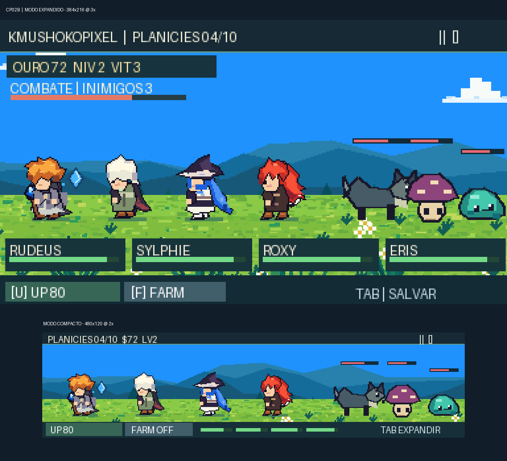
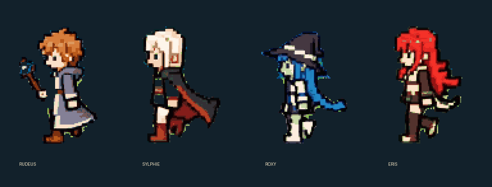

# KMushokoPixel — Checkpoint 03

**RPG idle lateral em pixel art para Godot 4.7.2**, com visual inspirado no Reel de referência (Rudeus, Sylphie, Roxy e Eris) e ciclo de fases/chefes inspirado em Task Bar Hero.

O projeto mantém o cenário de paralaxe e o quarteto do CP01A. Agora é **jogável**: 10 fases, 6 tipos de monstros em pixel art original, um elite (fase 5), um chefe (fase 10), combate automático de 4 heróis com habilidades diferentes, XP, ouro, evolução de equipe e salvamento de progresso. Após o primeiro chefe, ativa farm da fase 9.


*Prévia acima é uma composição ilustrativa feita com os sprites do projeto, não um screenshot direto do editor Godot.*

## Checkpoint 02B — restauração da pixel art

Corrigimos escalas fracionárias, ancoragem dos sprites no chão, camadas de renderização do HUD e efeitos de combate. Os personagens continuam na ordem visual do Reel e as funções do RPG foram preservadas.



*Comparação de layout feita com os sprites reais e em escala inteira (não é captura da execução no Godot).*

- **Expandido:** 384×216 pixels lógicos × 3 = 1152×648.
- **Compacto:** 480×120 pixels lógicos × 2 = 960×240.
- **Diferenciais:** HUD independente da vegetação, efeitos de magia próprios e pés alinhados.

O foco aqui é **correção técnica e consistência visual**. O refinamento artístico completo para atingir a qualidade do Reel ainda será feito com comparação quadro a quadro. [Detalhes do CP02B](docs/CP02B_VISUAL_REFINEMENT.md).

## CP03 — Combate visível e chefe com duas fases

- Efeitos pixel art **no cenário**: pedras voando (Rudeus), água/gelo (Roxy), cruzes de cura e escudos (Sylphie), cortes de espada (Eris) e golpes de inimigos.
- Os sinais de perigo aparecem **antes** do dano do Lobo Alfa, inclusive no modo compacto.
- Ao chegar a 55% de vida, o Lobo Alfa entra na segunda fase, convoca dois lobos e alterna investida e uivo em área; congelamento interrompe a preparação.
- O módulo visual `scripts/fx/combat_fx.gd` nunca controla o dano: toda a simulação continua em `scripts/combat/game_session.gd`.
- As artes dos personagens existentes continuam no mesmo estilo e resolução, sem trocar o visual aprovado por assets de terceiros.

**Teste específico:** `godot --headless --path . --script res://tests/test_boss_mechanics.gd`.

Veja [CP03: Batalha e chefe](docs/CP03_BOSS_AND_COMBAT_PRESENTATION.md).

## CP03C — Reboot visual (em avaliação)



Nesta branch foram substituídas as versões genéricas dos quatro heróis por **sprites de estudo extraídos/reconstruídos da referência em vídeo**, com quatro poses de caminhada, variações de repouso, casting e reação. As poses de referência olham para a esquerda; a exploração desloca o cenário para a direita e o combate inverte a orientação para encarar os inimigos. O gerador de sprites agora usa arquivos-fonte em `assets/characters/source/` para que o CI **não sobrescreva a arte**.

Também foram refeitos os seis monstros, a HUD (topbar + cartões menores de HP, sem cobrir a ação), os detalhes de gramado e o renderizador de efeitos para suporte a fogo, água, vento, gelo, terra, cura, escudos, espada e flechas futuras.

### Direitos dos materiais de referência

O Reel enviado é uma referência **não licenciada para reutilização pública**. Os sprites reconstruídos a partir dos seus quadros são **assets temporários de estudo**, não autorizados para publicação comercial. Antes de distribuir o jogo, será necessário confirmar autorização para personagens e imagens, ou substituí-los por assets próprios aprovados. O sprite de estudo não é um desenho original independente do Reel. Nenhum vídeo completo foi incluído.

### Como testar

```sh
python -m pip install 'Pillow>=10,<13'
python tools/validate_assets.py
python tools/validate_visual_pipeline.py
godot --headless --path . --script res://tests/test_asset_loading.gd
godot --headless --editor --path . --quit
godot --headless --path . --script res://tests/test_visual_reboot.gd
godot .
```

A apresentação 8-bit é um trabalho em evolução: primeiro validar movimento em Windows e HUD nos dois modos; depois redesenhar as peças a partir das referências como **arte original de produção**. A lógica das fases, cooldowns e salvamento permanece a do CP03.

## Rodar

Abra `project.godot` no Godot 4.x e pressione **F5**. Os personagens caminham, encontram inimigos, lutam e avançam automaticamente. Com a janela em qualquer modo, o combate é o mesmo.

| Tecla | Ação |
|---|---|
| TAB | Janela compacta / expandida |
| Espaço | Pausar |
| U | Melhorar equipe usando ouro |
| F | Alternar farm de fases concluídas |
| S | Salvar progresso |
| H | Esconder/exibir HUD |
| T | Fixar/desafixar janela acima de outras |
| Esc | Sair do compacto |

## Testes

```bash
python -m pip install 'Pillow>=10,<13'
python tools/validate_data.py
python tools/validate_assets.py
python tools/validate_combat_data.py
python tools/generate_monsters.py
python tools/generate_effects.py
python tools/validate_visual_pipeline.py
godot --headless --editor --path . --quit
godot --headless --path . --script res://tests/test_game_session.gd
godot --headless --path . --quit-after 120
```

Veja [detalhes e limitações do checkpoint](docs/CP02_IMPLEMENTATION.md), [planejamento de jogo](docs/GDD.md) e [direção visual fiel ao Reel](docs/ART_BIBLE.md).

**Status artístico:** o estilo é uma primeira aproximação do Reel, não uma cópia perfeita. Os sprites continuam passíveis de refinamento visual. O CP03C contém sprites de estudo derivados de quadros do Reel fornecido pelo usuário. Esses sprites são temporários, sujeitos a autorização e não estão licenciados para distribuição comercial. Personagens de Mushoku Tensei pertencem a seus detentores e requerem atenção aos direitos antes da distribuição.

## Primeira execução após o clone (Godot 4.7.2)

O jogo suporta executar `godot .` diretamente sem importar recursos no editor.
As texturas PNG são carregadas pelo Godot normalmente quando importadas; sem cache
`.godot/`, um carregador alternativo lê os PNGs do repositório e cria as texturas.
Isso evita os retângulos de emergência e os avisos de parallax ausente.

Teste rápido, **antes de abrir o editor**, no diretório do projeto:

```sh
godot --headless --path . --script res://tests/test_asset_loading.gd
godot .
```

Se o teste relatar PNG inexistente, verifique os arquivos no diretório `assets/`.
Não é necessário copiar a pasta `.godot/` de outro computador.

## CP03D — Direção do grupo e animações consistentes

A equipe caminha para a **esquerda**, como no Reel. Os monstros surgem
**à esquerda** e olham para a direita, de frente para os heróis. Em combate,
Eris assume a linha da frente e Rudeus/Sylphie/Roxy ficam atrás dela.
Os oito frames da caminhada reutilizam uma única face/roupa por personagem:
três poses de pernas e capas variam, mas não há troca de skin.

Validação: `python tools/validate_walk_consistency.py` e
`godot --headless --path . --script res://tests/test_party_direction.gd`.
Detalhes em [CP03D](docs/CP03D_WALK_AND_ENCOUNTERS.md).
