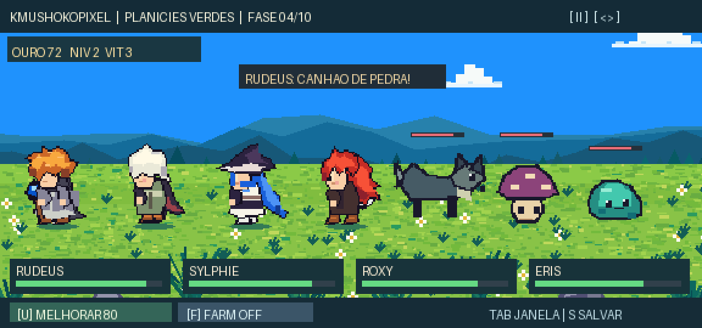

# KMushokoPixel — Checkpoint 02

**RPG idle lateral em pixel art para Godot 4.5.1**, com visual inspirado no Reel de referência (Rudeus, Sylphie, Roxy e Eris) e ciclo de fases/chefes inspirado em Task Bar Hero.

O projeto mantém o cenário de paralaxe e o quarteto do CP01A. Agora é **jogável**: 10 fases, 6 tipos de monstros em pixel art original, um elite (fase 5), um chefe (fase 10), combate automático de 4 heróis com habilidades diferentes, XP, ouro, evolução de equipe e salvamento de progresso. Após o primeiro chefe, ativa farm da fase 9.



*Prévia acima é uma composição ilustrativa feita com os sprites do projeto, não um screenshot direto do editor Godot.*

## Rodar

Abra `project.godot` no Godot 4.x e pressione **F5**. Os personagens caminham, encontram inimigos, lutam e avançam automaticamente. Com a janela em qualquer modo, o combate é o mesmo.

| Tecla | Ação |
|---|---|
| TAB | Janela compacta / expandida |
| Espaço | Pausar |
| U | Melhorar equipe usando ouro |
| F | Alternar farm de fases concluídas |
| S | Salvar progresso |
| H | Esconder/exibir HUD |
| T | Fixar/desafixar janela acima de outras |
| Esc | Sair do compacto |

## Testes

```bash
python -m pip install 'Pillow>=10,<13'
python tools/validate_data.py
python tools/validate_assets.py
python tools/validate_combat_data.py
python tools/generate_monsters.py
godot --headless --editor --path . --quit
godot --headless --path . --script res://tests/test_game_session.gd
godot --headless --path . --quit-after 120
```

Veja [detalhes e limitações do checkpoint](docs/CP02_IMPLEMENTATION.md), [planejamento de jogo](docs/GDD.md) e [direção visual fiel ao Reel](docs/ART_BIBLE.md).

**Status artístico:** o estilo é uma primeira aproximação do Reel, não uma cópia perfeita. Os sprites continuam passíveis de refinamento visual. Não há imagens copiadas do vídeo nas assets do jogo. Personagens de Mushoku Tensei pertencem a seus detentores e requerem atenção aos direitos antes da distribuição.